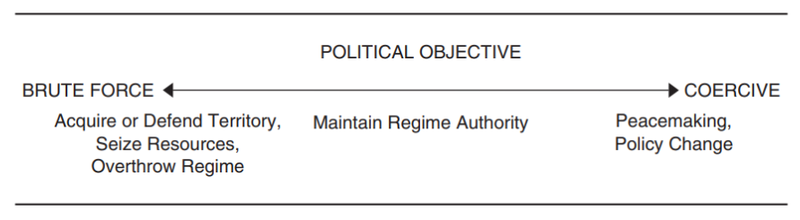

 by Elizabeth Butler, 1879. It depicts assistant surgeon William Brydon, one of the few survivors of 16,000 British and East India Company forces and civilians who fled Kabul during the First Anglo-Afghan War. Later that year, the British withdrew from Afghanistan, ending the war. This painting contributed to Afghanistan’s reputation as a graveyard of empires.](images/WhoWinsWars_Remnants.jpg){fig-alt="The painting 'Remnants of an Army' by Elizabeth Butler. It depicts a single rider on an exhausted horse approaching a settlement. The rider is assistant surgeon William Brydon, one of the few survivors of 16,000 British and East India Company forces and civilians who fled Kabul during the First Anglo-Afghan War. Later that year, the British withdrew from Afghanistan, ending the war. This painting contributed to Afghanistan’s reputation as a graveyard of empires."}

Two countries go to war. Who is going to win? It seems like the stronger country should win, but then why has Ukraine been able to hold off Russia? Why hasn’t the United States defeated Iran?

There are plenty of cases where superpower states had to retreat. The United States in Vietnam or Afghanistan comes to mind. Afghanistan also resisted invasions by the Soviet Union and the British Empire, earning it the title ‘the graveyard of empires’. 

Afghanistan’s success raises two key points for understanding who wins wars. First, along with capability, a state’s success in war also depends on its resolve. A state’s capability represents its military strength, or its ability to impose costs on its adversary. A state’s resolve is based on its motivations, or how much cost it is willing to tolerate.^[Maoz, Zeev. 1983. “Resolve, Capabilities, and the Outcomes of Interstate Disputes, 1816-1976.” Journal of Conflict Resolution 27 (2): 195–229. https://doi.org/10.1177/0022002783027002001. Sullivan, Patricia L. 2007. “War Aims and War Outcomes: Why Powerful States Lose Limited Wars.” Journal of Conflict Resolution 51 (3): 496–524. https://doi.org/10.1177/0022002707300187.] Thus, Afghanistan’s success may be partly due to its resolve.

Second, war outcomes are judged based on each side’s goals and gains.^[The Militarized Interstate Dispute dataset defines victory as a favorable alteration in the status quo.(Dispute Coding Manual, found in the [MID 5 Data and Supporting Materials](https://correlatesofwar.org/data-sets/mids/)) The International Crisis Behavior dataset determines victory based on the achievement of goals (Brecher, Michael, Jonathan Wilkenfeld, Kyle Beardsley, Patrick James and David Quinn (2025). International Crisis Behavior Data Codebook, Version 16. http://sites.duke.edu/icbdata/data-collections/).] Throughout the Afghanistan War, the Taliban never occupied any U.S. territory, but that wasn’t their goal; they only wanted to retake control of the Afghan government. So when we ask ‘Who wins wars?’, what we are really asking is ‘In war, who makes gains and achieves their goals?’

Research shows that states are more likely to achieve their goals when they 1) fight closer to home, 2) choose appropriate force deployment, and 3) have aims that don’t require their adversary’s cooperation. Additionally, 4) initiating states and 5) democracies win more often (maybe).

I discuss these factors below, but it is puzzling that there are any factors at all. The usual question asked in foreign affairs is: if states are making rational decisions based on cost-benefit analysis, then why do states fight costly wars instead of making a bargain that keeps the peace and leaves both sides better off? 

As we look at these factors related to success, the question that should be asked is: why do these factors affect a war’s outcome instead of simply being factored into the pre-war bargain? There should be some explanation for how each factor exacerbates the barriers to peace that I covered in the post [How War’s End](https://abroadreview.com/posts/HowWarsEnd.html). In brief, the main barriers are uncertainty, inability to credibly commit, private benefits to leaders, and human psychology. 

## Distance

The U.S. performs worse in international militarized disputes that are further away. Over time, the U.S. has fought disputes farther from home, moving from the Western Hemisphere to Europe, Asia, and the Middle East after World War II. Research finds that as the distance increases, the U.S. is less likely to succeed.^[Hulme, M. Patrick, and Erik Gartzke. 2021. “The Tyranny of Distance: Assessing and Explaining the Apparent Decline in U.S. Military Performance.” International Studies Quarterly 65 (2): 542–50. https://doi.org/10.1093/isq/sqaa067.] 

Fighting further away from home is challenging. Projecting force farther away is costly, decreasing the capabilities that can actually be applied. The United States may have less information about distant foes, creating uncertainty about the adversary’s capabilities and resolve. Lack of cultural understanding can hinder the United States’ ability to plan and operate effectively, further constraining its capabilities. Additionally, when the adversary is further away, it may seem less salient to national security and thus have less public support, diminishing U.S. resolve. 

Assuming the United States government understands these challenges, it should factor them into its pre-war negotiations and try to reach agreements that avoid distant wars. Scholars have suggested that the decreased information about the foe and about domestic public support make it more difficult for decision-makers to predict their odds of victory. That uncertainty may leave more room for the generally hawkish ideology of U.S. foreign policy to err on the side of overconfidence.^[Hulme and Gartzke 2021]

## Force Deployment

Capability depends not just on what is deployed but also on how they are deployed. The most effective method depends on the type of conflict. In theaters like World War I, armies that used a combination of cover, concealment, dispersion, suppressive fire, combined arms, and depth and reserve, referred to as the modern system, had a major advantage on the battlefield.^[Biddle, Stephen. 2004. Military Power: Explaining Victory and Defeat in Modern Battle. Princeton University Press.] 

A study of asymmetric conflicts - conflicts between a strong power and a weak power - looked at how each side can choose a direct or indirect strategy. Direct strategies target your opponent’s forces to erode their capacity to fight. Indirect strategies target your opponent’s will to fight through guerrilla warfare for weak powers or targeting civilians for strong powers. The strong power has succeeded in 76% of cases where the strong power chooses the same strategy as the weaker power (i.e., direct vs. direct or indirect vs. indirect). When the strategies mismatch, the strong power has only succeeded in 37% of cases.^[Arreguin-Toft, Ivan. 2001. “How the Weak Win Wars: A Theory of Asymmetric Conflict.” International Security 26 (1): 93–128.]

Why don’t forces always choose the optimal strategy? First, complex force deployment methods like the modern system may be difficult to master.^[Arreguin-Toft 2001, Biddle 2004.] Second, forces are developed to fight in a certain way, perhaps based on national identity, military tradition, or to counter a primary adversary. Once equipment is acquired and soldiers are trained, they may be ill-suited to employ the ideal strategy or tactics for other conflicts. For example, the mechanization of modern armies (i.e., tanks, trucks, aircraft) has decreased their effectiveness fighting insurgencies like the U.S. in Vietnam or the USSR in Afghanistan.^[Lyall, Jason, and Isaiah Wilson III. 2009. “Rage Against the Machines: Explaining Outcomes in Counterinsurgency Wars.” International Organization 63 (1): 67–106. https://doi.org/10.1017/S0020818309090031.]

So why can’t states account for force deployment in their pre-war estimates and reach a deal? Uncertainty seems a likely explanation. That same national identity that led a state to adopt suboptimal force deployment may also cause them to overestimate its effectiveness. In the case of asymmetric wars, it may be unclear what strategy the adversary is going to use. In some cases, the strategy may shift. In the Vietnam War, the weaker power’s strategy shifted from direct engagement to indirect guerrilla warfare after the U.S. defeated the North Vietnamese Army.^[Arreguin-Toft 2001]

## Aims

Military interventions by major powers are more successful when their objective is less reliant on compliance from their adversary.^[Sullivan, Patricia L. 2007. “War Aims and War Outcomes: Why Powerful States Lose Limited Wars.” Journal of Conflict Resolution 51 (3): 496–524. https://doi.org/10.1177/0022002707300187.] Some objectives lend themselves to brute force, such as acquiring territory, seizing resources, or overthrowing a regime. The adversary can resist these objectives and impose costs on the major power, but ultimately the major power can succeed with sufficient force. Other objectives such as policy change or peacemaking require some level of cooperation by the adversary. While the major power can still use force to impose costs on the adversary, it is ultimately up to the adversary to agree to change their policy or make peace. The full spectrum of objectives is shown in Figure 2. 

{fig-alt="A screenshot of a figure from Sullivan 2007. The figure is titled Political Objectives. There is a line representing a spectrum from Brute Force on the left to Coercive on the right. Under Brute Force are the examples Acquire or Defend Territory, Seize Resources, Overthrow Regime. In the middle is Maintain Regime Authority. On the right under Coercive is Peacemaking and Policy Change."}

Analysis across 120 interventions shows that military capabilities do not explain success, but the aims do. When a major power has a brute force objective, its predicted probability of success is over 75%. When they have a fully coercive goal, their probability of success is only 20%. In addition, the major power is 20% more likely to succeed when they are acting in support of a local government, but 62% less likely to succeed if the adversary is supported by troops from an ally.

What explains the different outcomes between brute force and coercive aims? Because they affect what is important for success. Compared to each other, brute force goals depend more on capacity (i.e., military forces) and coercive aims depend more on resolve (i.e., will to fight). Of the two factors, resolve is more difficult to assess. This means the major power will likely be less accurate in its pre-war estimates of the costs of conflict, leading it to launch interventions that it cannot sustain.^[Sullivan 2007]

## Democracy

Democracies are theorized to be more successful in war because (1) democratic leaders should be more concerned about being voted out if they lose a war and (2) freedom of speech and press in democracies makes for a robust marketplace of ideas which helps democratic leaders make better estimates of the likelihood of success and avoid risky wars.^[Reiter, Dan, and Allan C. Stam. 2002. Democracies at War. Princeton University Press.] To the first point, see my review on leader consequences for war.

The actual evidence that democracies are more successful in war varies depending on how you set up the analysis. If you look at wars between 1816-1987 and ignore wars that ended in draws, then democracies win 93% of the wars they start while non-democracies win 60%.^[Rieter and Stam 2002.
Downes, Alexander B. 2009. “How Smart and Tough Are Democracies? Reassessing Theories of Democratic Victory in War.” International Security 33 (4): 9–51.
Reiter, Dan, Allan C. Stam, and Alexander B. Downes. 2009. “Another Skirmish in the Battle over Democracies and War.” International Security 34 (2): 194–204.]  If your country is starting a war, seems better to live in a democracy. 

However, if you do account for wars that ended in draws, democracies win 65% of the wars they start versus 51% for non-democracies; this smaller difference is not statistically significant, meaning that the difference is small enough that we cannot be confident that it is not just due to chance.^[Research currently under review finds further evidence that there is no 'democratic advantage' for initiating a war. Downes, Alexander, and Jason Lyall. 2026. “Reassessing the Democratic Advantage in War.” Jvryq_v1. Preprint, SocArXiv, October 16. https://osf.io/preprints/socarxiv/jvryq_v1/.] But if you include initiators and defenders, count all wars, and include draws, democracies win 59% vs. non-democracies 40%, which is statistically significant.

## Initiation

While both states may fail to reach a pre-war agreement, the state that actually initiates the war is more likely to win (53%) than defenders (34%).^[Reiter et al 2009] A simple explanation is that the initiator must believe they will win, and we can assume that this belief must be grounded in reality.^[Reiter, Dan, and Allan C. Stam III. 1998. “Democracy, War Initiation, and Victory.” American Political Science Review 92 (2): 377–89.] That seems like a pretty big assumption though, and it does not answer the question of why the defender wasn’t able to reach a pre-war deal. We can speculate that the initiator might gain some first strike advantage, or the defender may have uncertainty whether the initiator is bluffing or can even credibly commit to a deal. I am unaware of any research that tests these or other explanations. Still, some have argued that war initiation is difficult to code or makes little sense given the possibility for pre-war bargains.^[Croco, Sarah E., and Jessica LP Weeks. 2016. “War Outcomes and Leader Tenure.” World Politics 68 (4): 577–607.]

## Human Rights

Do human rights affect war outcomes? If we assume that democracies have better human rights records than the above, discussion suggests a correlation between human rights and war victory, but it is unclear what that mechanism would be.

There is some evidence that states with worse human rights may strengthen the resolve of their opponent. Survey experiments in the United States and United Kingdom found that public support for a hypothetical war increased when the target reportedly violated human rights; respondents were more likely to see the target as a threat and had fewer moral qualms about going to war.^[Tomz, Michael R., and Jessica L. P. Weeks. 2020. “Human Rights and Public Support for War.” The Journal of Politics 82 (1): 182–94. https://doi.org/10.1086/705741.] However, how long that support lasts is another question.

## Good Answers, Better Questions

We reviewed six factors that can affect who wins a war: distance, force deployment, aims, democracy, initiation, and human rights. These are good answers supported by quality research, but the focus on war victory obscures the bigger picture. The start of a war already represents a bargaining failure. Once the fighting has begun, it is obviously preferable to win, but it would have been better to reach a deal that accomplished your goals without a war. Instead of asking ‘Who Wins Wars?’ what we really want to know is which state is more successful in the grand scheme of foreign affairs, and the onset of war already indicates a failure.

*Acknowledgements: Thanks to Lucy Ouckama and Hannah Valdez for draft comments. Thanks to Coefficient Giving for supporting this Living Lit Review.*

